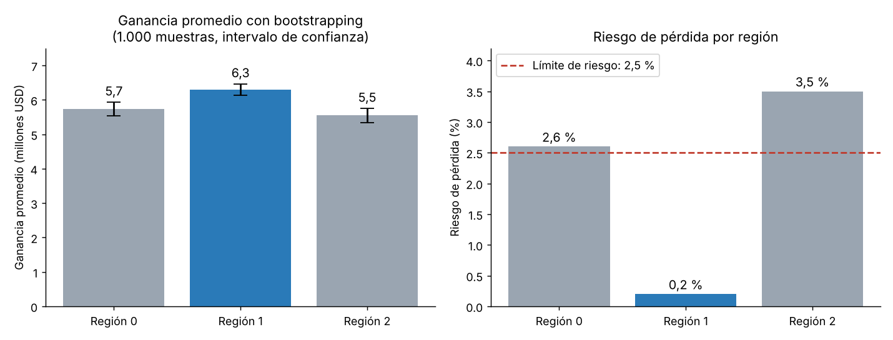

# Selección de región para nuevos pozos petroleros — OilyGiant

Proyecto de machine learning aplicado a decisiones de inversión, del bootcamp de Ciencia de Datos de TripleTen.

## Problema de negocio

La compañía petrolera OilyGiant debe elegir en cuál de tres regiones abrir 200 pozos nuevos, con un presupuesto de **USD 100 millones**. La región elegida debe maximizar la ganancia y tener un **riesgo de pérdida menor al 2,5 %**.

## Datos

- Tres conjuntos de datos (`geo_data_0`, `geo_data_1` y `geo_data_2`), uno por región, con 100.000 puntos de exploración cada uno.
- Cada punto tiene tres características geológicas y el volumen de reservas (en miles de barriles).

## Metodología

1. **Preparación**: revisión de duplicados y valores nulos.
2. **Modelado**: un modelo de **regresión lineal** por región (partición 75/25) para predecir el volumen de reservas, evaluado con RMSE.
3. **Cálculo de la ganancia**: punto de equilibrio por pozo y ganancia de los 200 pozos con mayor reserva predicha.
4. **Análisis de riesgo con *bootstrapping***: 1.000 muestras aleatorias de 500 puntos por región; en cada una se seleccionan los 200 mejores pozos y se calcula la ganancia. Con eso se obtienen la ganancia promedio, el intervalo de confianza del 95 % y el riesgo de pérdida.

## Resultados

| Región | Ganancia promedio (*bootstrapping*) | Riesgo de pérdida | Decisión |
|---|---|---|---|
| geo_data_0 | USD 5,7 millones | 2,6 % | Descartada (supera el 2,5 %) |
| **geo_data_1** | **USD 6,3 millones** | **0,2 %** | **Recomendada** |
| geo_data_2 | USD 5,5 millones | 3,5 % | Descartada (supera el 2,5 %) |

## Gráficas

**Ganancia promedio y riesgo de pérdida por región (elaborada con los resultados del notebook)**

## Conclusiones

- Sin análisis de riesgo, la región 0 parecía la mejor opción (ganancia estimada de USD 31,8 millones en los 200 mejores pozos), pero su RMSE de 37,8 ponía en duda la estimación.
- El *bootstrapping* mostró que la región 0 supera el límite de riesgo y que la **región 1** ofrece la mayor ganancia promedio con un riesgo de pérdida de solo 0,2 %.
- En la región 1 el modelo tiene un RMSE de 0,89, frente a 37,8 y 40,0 en las otras dos regiones, lo que hace mucho más confiable la selección de pozos.

## Herramientas

Python · pandas · NumPy · SciPy · scikit-learn

## Archivos

- [`oilygiant_seleccion_region_pozos.ipynb`](oilygiant_seleccion_region_pozos.ipynb): notebook completo con código y análisis.
- `requirements.txt`: librerías utilizadas.

Los datos fueron proporcionados por TripleTen y no se incluyen en el repositorio. El notebook conserva las salidas de la ejecución original.

---

**Iván Ricardo Navarro Espinosa** — Ingeniero Químico, MSc · [GitHub](https://github.com/ivanrnavarro) · ivanrnavarro@gmail.com
Más proyectos del bootcamp en [tripleten-ciencia-de-datos](https://github.com/ivanrnavarro/tripleten-ciencia-de-datos).
